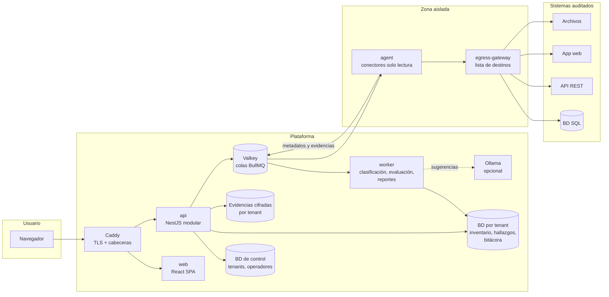
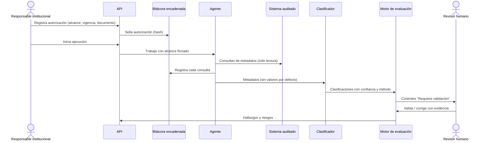
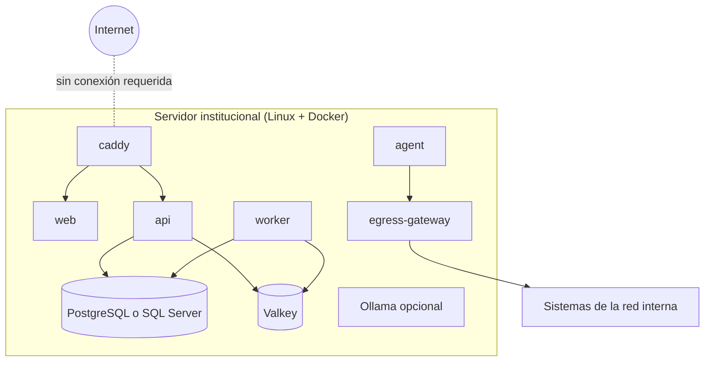
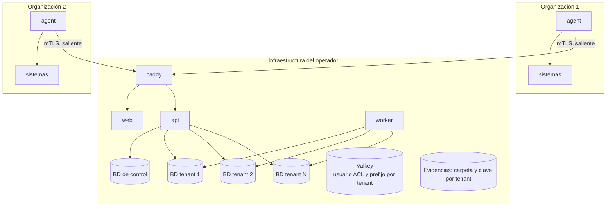
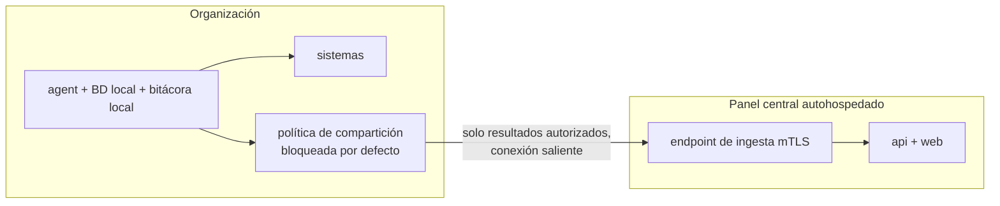

# 5. Arquitectura técnica y 6. Diagramas

Estado: **Diseñado**. Los diagramas usan Mermaid (GitHub los renderiza).

## 5.1 Estilo arquitectónico

**Decisión D-36: monolito modular** (una API NestJS con módulos por dominio) + **workers** del mismo código con otro punto de entrada + **agente auditor** desplegable por separado. No se usan microservicios: aumentarían costo operativo y superficie de ataque sin beneficio para instituciones pequeñas (KISS, sección 3.2).

Dentro de cada módulo se aplica una separación inspirada en Clean Architecture solo donde aporta valor (motores de clasificación, evaluación y riesgo):

```
módulo/
  domain/          entidades y reglas puras (sin dependencias de framework)
  application/     casos de uso, puertos (interfaces)
  infrastructure/  adaptadores: Prisma, colas, conectores, IA
  interface/       controladores REST, DTOs validados
```

## 5.2 Stack seleccionado

| Capa | Tecnología | Decisión |
|---|---|---|
| Lenguaje | TypeScript estricto (`strict: true`) | Especificación §3.2 |
| Runtime | Node.js 24 LTS (evaluar 26 LTS al iniciar Fase 1) | D-14 |
| Monorepo | pnpm workspaces | D-13 |
| Backend | NestJS, REST, OpenAPI 3 generado desde decoradores | D-15 |
| Validación | zod (esquemas compartidos frontend/backend/IA) | D-15 |
| ORM | Prisma 7 con adaptadores PostgreSQL y SQL Server | D-03, D-15 |
| Colas | Valkey + BullMQ | D-17 |
| Frontend | React + Vite + React Aria Components + TanStack Query | D-16 |
| Gráficos | Recharts | D-16 |
| Reportes | HTML → PDF con Playwright (Chromium headless); exceljs; CSV nativo | D-19 |
| IA | Ollama (opcional, desactivado por defecto) | D-07, D-21 |
| Proxy inverso | Caddy (TLS con CA interna para instalaciones sin Internet) | D-37 |
| Almacenamiento de evidencias | Sistema de archivos por tenant, cifrado con clave del tenant | D-38 |
| Pruebas | Vitest (unitarias/integración), Playwright Test (E2E), Testcontainers | D-39 |
| Contenedores | Docker + Docker Compose (perfiles por modalidad) | D-29 |

## 5.3 Estructura del repositorio (objetivo de Fase 1)

```
apps/
  web/            SPA React
  api/            API NestJS (+ punto de entrada worker)
  agent/          agente auditor (ejecución aislada y Modalidad C)
packages/
  shared/         tipos y esquemas zod compartidos
  connector-sdk/  contrato de conectores y utilidades anti-SSRF
  classifier/     reglas determinísticas de clasificación
  catalog-schema/ esquema y validador del catálogo normativo
  audit-log/      bitácora encadenada por hash
catalog/          catálogo normativo versionado (YAML, firmado al publicar)
deploy/compose/   perfiles: local (A), multitenant (B), hybrid-agent (C)
docs/             documentación en español
```

## 6.1 Diagrama de componentes



Reglas del diagrama:
- El **agente** es el único componente que alcanza sistemas auditados, y solo a través del **egress-gateway** configurado desde la autorización de auditoría vigente.
- **Ollama** no tiene acceso a red ni a herramientas; recibe texto minimizado y devuelve JSON validado.
- La **API** nunca se conecta a sistemas auditados.

## 6.2 Flujo de una auditoría



## 6.3 Diagramas de despliegue

### Modalidad A — Instalación institucional local



Instalación desde paquete offline: imágenes (`docker save`), catálogo normativo firmado, modelos opcionales, documentación y archivos de verificación de firmas.

### Modalidad B — Multiempresa autohospedada



### Modalidad C — Híbrida opcional



Reglas (D-10): el agente **solo inicia conexiones salientes**; no abre puertos entrantes; cada envío queda registrado localmente con su contenido exacto; el certificado del agente puede revocarse desde ambos extremos; la desconexión permanente elimina credenciales y configuración del destino.

## 5.4 Decisiones de arquitectura transversales

- **Sin telemetría** externa de ningún tipo (D-30).
- **Sin actualizaciones automáticas**: el administrador descarga, verifica firma y aplica (D-30).
- **Sin CDN** en el frontend: todos los recursos se empaquetan.
- **Configuración** por variables de entorno y archivos montados; secretos solo por archivo (`*_FILE`), nunca en variables visibles en `docker inspect`.
