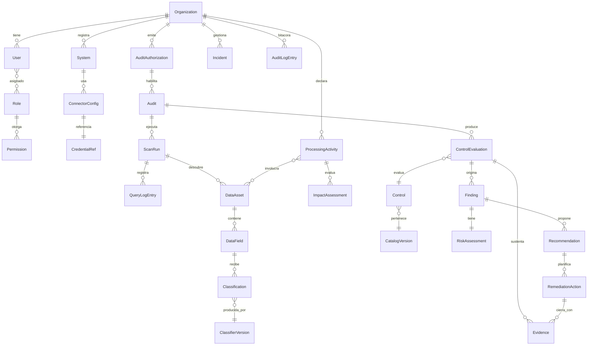

# 7. Modelo de datos preliminar

Estado: **Diseñado (preliminar)**. Nombres de entidades en inglés (convención de identificadores, §3.1); descripciones en español. El esquema Prisma definitivo se produce en las Fases 2–8.

## 7.1 Separación de bases de datos (D-04)

- **BD de control** (una por instalación): operadores de plataforma, tenants, configuración global, versiones del catálogo instaladas.
- **BD de tenant** (una por organización): todo lo demás. En Modalidad A hay un solo tenant.

## 7.2 Diagrama entidad-relación (BD de tenant, núcleo)

## 7.3 Entidades principales

| Entidad | Atributos clave | Notas de privacidad y seguridad |
|---|---|---|
| `User` | id, email, nombre, estado, mfaEnabled, lastLoginAt | Datos personales de la plataforma (O-01). Contraseña con argon2id en tabla separada `UserCredential`. |
| `Role`, `Permission` | RBAC + condiciones contextuales | Roles base en §7.5. |
| `System` | nombre, tipo, responsable, criticidad, entorno | Sistema auditable registrado. |
| `ConnectorConfig` | tipo, host, puerto, opciones, límites (consultas, tiempo, filas de muestra) | Límites por defecto conservadores. |
| `CredentialRef` | id, algoritmo, ciphertext, keyVersion, createdBy, revokedAt | Cifrado de sobre AES-256-GCM (D-12). Nunca se devuelve por la API. En Modalidades B y C la credencial **vive solo en el agente local** de la organización; la plataforma central guarda únicamente una referencia opaca (D-43). |
| `AuditAuthorization` | alcance (sistemas, operaciones), vigenciaDesde/Hasta, firmante, documentoHash, estado | Sin autorización vigente no hay ejecución (A-01). |
| `ScanRun` | auditId, estado, inicio, fin, limitesAplicados, motivoCancelación | Cancelable en cualquier momento. |
| `QueryLogEntry` | scanRunId, conector, operación, texto de consulta normalizado, filas leídas, duración, hash encadenado | Registro de consultas (Centro de Confianza §15.2). Nunca guarda valores devueltos. |
| `DataAsset` | sistema, tipo (tabla, endpoint, formulario, archivo), ruta/nombre, volumen estimado | Inventario de activos. |
| `DataField` | assetId, nombre, tipo de dato, nulabilidad, comentario/metadatos | Solo metadatos. |
| `Classification` | fieldId, categoría, subcategoría, confianza (0–1), método (regla, metadato, patrón, contexto, IA, humano), justificación, evidenciaId, fecha, classifierVersionId, estadoValidación | Campos exigidos por §10. |
| `ProcessingActivity` | finalidad, base de licitud declarada, categorías de titulares, plazos de conservación, destinatarios, transferencias | Registro de actividades de tratamiento. Base de licitud siempre declarada por humano. |
| `ImpactAssessment` | actividadId, estado, resultado, aprobadoPor | Submódulo O-03. |
| `CatalogVersion` | versión semántica, fechaVigenciaNormativa, fuente, hash, firma, publicadaEn | Parámetro de vigencia (D-05). |
| `Control` | código, título, referencia normativa exacta, tipo (obligación legal, recomendación técnica, buena práctica, requisito condicionado), aplicabilidad, estadoRevisiónJurídica, método de evaluación | Ver `13-evaluacion-normativa.md`. |
| `ControlEvaluation` | controlId, resultado (Conforme, No conforme, Requiere validación, No evaluado, No aplicable), método, confianza, limitaciones, responsable, fecha, versión normativa | Regla D-06. |
| `Evidence` | tipo, hash SHA-256, ruta cifrada, origen, capturadaPor, fecha | Cadena de custodia (O-06). |
| `Finding` | descripción, requisito, explicación técnica, prioridad, estado | Campos §14. |
| `RiskAssessment` | probabilidad, impacto, riesgoInherente, controlesExistentes, riesgoResidual, incertidumbre, metodologíaVersion | §13. |
| `RemediationAction` | acción, responsable, esfuerzo (S/M/L/XL), fechaObjetivo, criterioAceptación, estado, evidenciaCierreId, reevaluaciónId | §14. |
| `Incident` | descripción, fecha de detección, sistemas, categorías de datos, evaluación de notificación, estado | Vinculado al art. 14 sexies [VERIFICADO epígrafe]. |
| `AuditLogEntry` | secuencia, actor, acción, objeto, timestamp, hashAnterior, hash | Bitácora encadenada solo-anexar (D-31). |

## 7.4 BD de control

| Entidad | Atributos |
|---|---|
| `Tenant` | id, nombre, estado, cadena de conexión (referencia a secreto), versión de esquema, política de retención |
| `PlatformOperator` | id, email, rol (sin acceso a contenido de tenants) |
| `BreakGlassRequest` | operador, tenant, motivo, aprobadoPorTenant, vigencia |
| `InstalledCatalog` | versión, hash, firma verificada, fecha |

## 7.5 Roles base

| Rol | Alcance |
|---|---|
| Administrador de organización | Usuarios, roles, configuración institucional. No ejecuta auditorías por sí solo (separación de funciones). |
| Responsable de auditoría | Crea autorizaciones (requiere segundo aprobador para alcance amplio), inicia y cancela ejecuciones. |
| Auditor | Revisa clasificaciones, evaluaciones, hallazgos. |
| Revisor jurídico | Único rol que puede fijar "Conforme" o "No conforme" en controles de tipo "obligación legal" (D-06, nivel evaluación). Distinto del revisor jurídico del catálogo, que pertenece al proyecto. |
| Responsable de remediación | Gestiona acciones correctivas asignadas. |
| Lector | Solo dashboards y reportes. |
| Operador de plataforma (BD de control) | Gestiona tenants; sin acceso a contenido (C-09). |

## 7.6 Retención

Cada tenant configura plazos por tipo de registro. Valores propuestos al configurar (deben confirmarse; no son recomendación legal) [PENDIENTE de revisión jurídica]: evidencias y hallazgos según política de la organización; bitácora encadenada sin borrado parcial (solo destrucción completa del tenant con acta, O-09).
