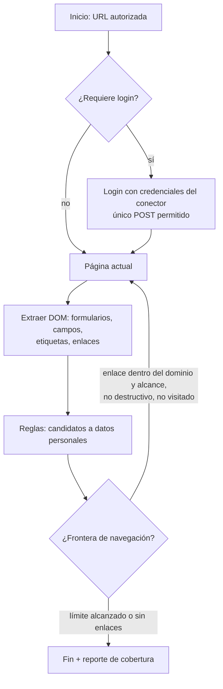

# 9. Diseño de agentes

Este documento cubre dos cosas distintas que la especificación llama "agentes":

- **Parte A — Agentes del producto**: el agente auditor y el agente de exploración web que se ejecutan dentro de la plataforma (secciones 9, 18 y módulo 21).
- **Parte B — Equipo multiagente de desarrollo**: cómo se organiza el trabajo de construcción del software (sección 2).

---

## Parte A — Agentes del producto

### A.1 Principio rector

Los agentes del producto son **orquestaciones determinísticas** que pueden pedir sugerencias a un modelo de IA local, pero **el modelo nunca elige acciones**. Las acciones posibles están cerradas por código, alcance y autorización. Esto es la defensa principal contra prompt injection (D-07, D-08).

### A.2 Agente auditor (Fases 3–4)

Proceso independiente (`apps/agent`) que:
1. Recibe un trabajo con el alcance firmado de una `AuditAuthorization` vigente.
2. Ejecuta conectores en orden, con límites y registro de consultas.
3. Envía metadatos descubiertos al clasificador.
4. Puede pausarse, reanudarse o cancelarse desde la interfaz o desde la línea de comandos local del servidor (control institucional §15.2).

### A.3 Agente de exploración web (Fase 10)

**Capacidades** (sección 9): reconocer módulos, identificar formularios y campos de información personal, reconocer flujos de captura, examinar permisos observables y registrar evidencias (capturas de pantalla con campos enmascarados).

**Modelo de ejecución**:

**Credenciales** (D-46): cuenta dedicada de mínimo privilegio creada por la organización para la auditoría; si la aplicación exige MFA, la organización decide cómo habilitarlo para esa cuenta; nunca cuentas personales ni administrativas.

**Restricciones técnicas** (D-08):
- Intercepción de red de Playwright: se abortan métodos distintos de GET/HEAD, salvo el formulario de login declarado.
- Lista de dominios permitidos; cualquier otro destino se aborta y se registra.
- No se envían formularios ni se escriben valores en campos (salvo login).
- Heurística de enlaces destructivos: no se siguen enlaces o botones cuyo texto, `href` o atributos contengan términos como "eliminar", "borrar", "delete", "logout", "pagar", "confirmar", "enviar" (lista configurable). Riesgo residual documentado.
- Navegador en contenedor sin privilegios, sin acceso al sistema de archivos del host, con memoria y tiempo limitados.
- Si se usa IA: recibe solo la estructura del formulario (etiquetas y nombres de campo, sin valores) y devuelve un JSON validado con zod; texto de la página que intente dar instrucciones se trata como dato.

### A.4 Orquestación (módulo 21)

Colas BullMQ con estados explícitos (`pending`, `running`, `paused`, `cancelled`, `completed`, `failed`), reintentos acotados, idempotencia por `scanRunId` y un único trabajo activo por sistema auditado para no sobrecargarlo.

---

## Parte B — Equipo multiagente de desarrollo

### B.1 Roles (sección 2)

| Rol | Responsabilidad | Puede aprobar |
|---|---|---|
| Orquestador | Plan de fase, dependencias, contratos técnicos, integración, registro de decisiones | Nada por sí solo (requiere QA y humano) |
| Agente Frontend | `apps/web`, accesibilidad WCAG 2.2 AA, dashboards | — |
| Agente Backend | `apps/api`, `packages/*`, motores, persistencia | — |
| Agente DevOps y Seguridad | `deploy/`, CI/CD, firmas, SBOM, escaneos | — |
| Agente QA | Pruebas, verificación de criterios de aceptación, evidencia de resultados | Cierre técnico de tareas de otros agentes |
| Revisión de arquitectura, privacidad y seguridad | Lista de verificación por fase | Dictamen documentado |
| **Revisión jurídica** | **Siempre humana.** Ningún agente de IA puede marcar un control como revisado jurídicamente. | Controles del catálogo |
| Responsable del proyecto (humano) | Aprobación de fase | Puerta de fase |

### B.2 Reglas de trabajo

1. Cada tarea tiene criterio de aceptación escrito **antes** de implementarse.
2. Los contratos (OpenAPI, esquemas zod, manifiestos de conectores) se acuerdan antes del código que los consume.
3. El orquestador no aprueba su propio trabajo; QA es un agente distinto del que implementó.
4. Si un rol especializado no está disponible, el orquestador registra la revisión como **[PENDIENTE]** y la escala al responsable humano.
5. Ningún agente inventa resultados de pruebas: todo resultado se acompaña del comando ejecutado y su salida.
6. Las definiciones operativas de cada rol están en `.claude/agents/` y las reglas comunes en `CLAUDE.md` del repositorio.
