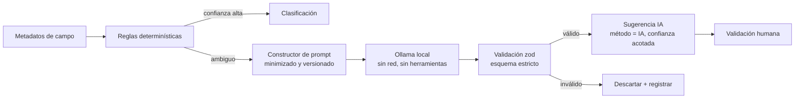

# 13. Estrategia de IA local

Estado: **Diseñado**. Decisiones **D-07, D-20, D-21**.

## 13.1 Rol de la IA

La IA es una **herramienta de apoyo**, nunca de decisión:

| La IA puede | La IA no puede |
|---|---|
| Sugerir categoría de un campo ambiguo a partir de su nombre, etiqueta y contexto | Leer valores de registros |
| Explicar en lenguaje claro un hallazgo ya determinado | Determinar el resultado de un control legal |
| Recuperar fragmentos del catálogo normativo pertinentes (RAG) para el revisor | Citar artículos que no estén en el catálogo versionado |
| Proponer redacción de recomendaciones | Ejecutar acciones, llamar herramientas o acceder a la red |

## 13.2 Arquitectura

- **Desactivada por defecto** (D-07): se activa por tenant desde la configuración institucional.
- **Interfaz de proveedor intercambiable**: contrato `InferenceProvider` con implementación Ollama; otros endpoints locales compatibles pueden agregarse. Proveedores remotos solo con configuración explícita y aviso (C-10).
- **RAG restringido** (D-20): corpus = solo el catálogo normativo instalado y su texto fuente. Embeddings almacenados en la BD; similitud calculada en la aplicación (sin base vectorial adicional). Toda cita generada se verifica contra los identificadores de control existentes; una referencia inexistente invalida la respuesta.
- **Confianza acotada**: una sugerencia de IA nunca supera el umbral que permite clasificación sin revisión humana.

## 13.3 Selección del modelo (D-21)

Criterios obligatorios, evaluados en la Fase 10 con un banco de pruebas propio sobre datos sintéticos:

1. Licencia aprobada por la OSI o equivalente libre (p. ej. Apache-2.0, MIT). Modelos con licencias comunitarias restrictivas no serán el valor por defecto.
2. Ejecutable en CPU con cuantización.
3. Rendimiento en español sobre nombres de campos y etiquetas reales chilenas (sintéticas).
4. Métricas medidas: precisión, exhaustividad, tasa de falsos positivos y negativos, tasa de salida inválida, latencia en CPU.

No se nombra aún un modelo concreto: elegirlo sin medición sería inventar un resultado. [PENDIENTE — Fase 10]

## 13.4 Requisitos de hardware [ESTIMACIÓN — validar en Fase 10]

La IA es opcional; la plataforma sin IA no requiere GPU. Con IA, el requisito dominante es la memoria RAM para un modelo pequeño cuantizado. Las cifras concretas se medirán en Fase 10 y se publicarán en el Manual de IA.

## 13.5 Gobierno de la IA

- Registro por inferencia: versión de modelo, hash del prompt, versión de plantilla, resultado validado, latencia.
- Plantillas de prompt versionadas en el repositorio y revisadas como código.
- Evaluación continua: el banco de pruebas corre en CI (con modelo pequeño) en cada cambio de prompt o modelo.
- Datos de organizaciones nunca usados para entrenamiento (sección 18).
